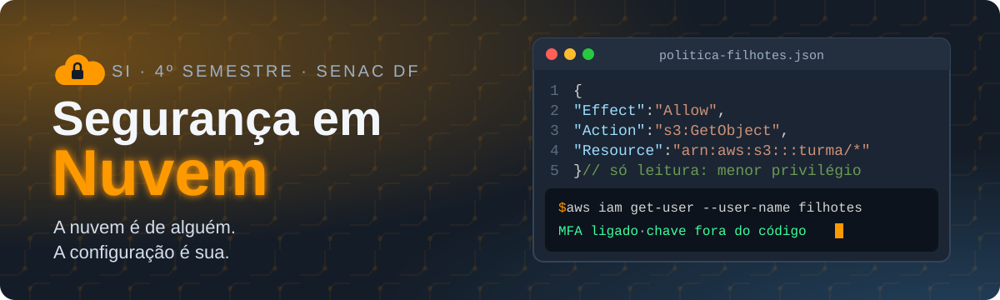

<p align="center">
  
</p>

<p align="center">
  
  
  
  
</p>

<p align="center">
  <b><a href="https://maristelaoliveira.github.io/seguranca-nuvem/">🌐 Abrir o site da disciplina</a></b>
  &nbsp;·&nbsp;
  <b><a href="https://maristelaoliveira.github.io/seguranca-nuvem/#aulas">📚 Ir direto para as aulas</a></b>
  &nbsp;·&nbsp;
  <b><a href="https://maristelaoliveira.github.io/seguranca-nuvem/quiz/">🎯 Quiz</a></b>
  &nbsp;·&nbsp;
  <b><a href="https://maristelaoliveira.github.io/seguranca-nuvem/quiz/simulado.html">🏅 Simulado SCS-C02</a></b>
</p>

---

## `$ aws sts get-caller-identity`

A primeira pergunta de segurança na nuvem é sempre a mesma: **quem sou eu?** Então lá vai:

Prazer, eu sou a **Profa. Maristela**, ou só **Stela**! 👋

Boas-vindas à **Segurança em Nuvem**, do curso de **Segurança da Informação** da Faculdade de Tecnologia e Inovação Senac DF (4º semestre, quartas de manhã, 70 horas: 60h presenciais e 10h a distância).

Este repositório é o **site da disciplina**: o lugar onde ficam as aulas, os laboratórios passo a passo, o quiz, o simulado e os materiais. Nada de slides: aqui a aula é o próprio site.

A nuvem é de alguém. A configuração é sua. Olha o menor privilégio funcionando:

```json
{
  "Effect": "Allow",
  "Action": "s3:GetObject",
  "Resource": "arn:aws:s3:::turma/*"
}
```

```text
$ aws s3 ls s3://turma
An error occurred (AccessDenied) when calling the ListObjectsV2 operation: Access Denied
```

> 🔐 Calma, não quebrou nada: a política só deixa **ler** os objetos, não **listar** o bucket. `AccessDenied` aqui é a segurança fazendo o trabalho dela. 🎉

---

## 🧭 O que tem no site

| | Seção | Para que serve |
|:-:|---|---|
| 🔬 | **Raio-X da nuvem** | Quem protege o quê (responsabilidade compartilhada) e seis fatos com fonte, como o caso Capital One. |
| 📜 | **Ementa e objetivos** | A ementa oficial e aonde a gente quer chegar. |
| 🧩 | **Conteúdo programático** | As cinco unidades, uma camada de proteção por vez. |
| 📚 | **Aulas** | Uma página por encontro, com conceitos, estudo de caso, laboratório na AWS Academy e checklist. |
| 🧪 | **Laboratório passo a passo** | Nas aulas 11 e 12, o laboratório da AWS Academy vem botão por botão (na aula 12, no Learner Lab). |
| 🎯 | **Quiz: segurança na AWS** | 20 questões embaralhadas, com a imagem do resultado no fim. |
| 🏅 | **Simulado AWS Security Specialty** | No estilo da certificação SCS-C02: múltipla escolha e múltipla resposta, com análise no fim. |
| 🔌 | **Segurança de APIs e serviços em nuvem** | Atividade interativa com teoria, incidentes reais e o estudo de caso FinCloud Market. |
| 📊 | **Avaliação** | Como a nota é montada nos dois bimestres. |

> O quiz e o simulado começam com o login do e-mail da faculdade, e o resultado fica registrado para a professora.

---

## 🗺️ A trilha do semestre

Cinco unidades, uma arquitetura de segurança no fim:

```text
$ aws cloudtrail lookup-events --semestre 2026.2

 U1  Cloud computing e fundamentos     quem protege o quê                 aulas 1 a 3
 U2  Proteção do acesso e da infra     portas trancadas, chaves com dono  aulas 4 a 6 e 9
 U3  Proteção dos dados na aplicação   o que vaza não volta               aulas 10 e 11
 U4  Logs, monitoramento e incidentes  ver, desconfiar e agir             aulas 12 a 14
 U5  Arquitetura para o cliente        juntar as peças                    aulas 15 e 16
```

> Esse `--semestre` não existe na AWS CLI de verdade. Mas a trilha existe, e a gente segue ela. 😉

| Aula | Tema | |
|:-:|---|:-:|
| 01 | Conhecendo a disciplina: por que proteger a nuvem? | [abrir](https://maristelaoliveira.github.io/seguranca-nuvem/aulas/aula-01.html) |
| 02 | Revisão dos conceitos de cloud computing | [abrir](https://maristelaoliveira.github.io/seguranca-nuvem/aulas/aula-02.html) |
| 03 | Fundamentos de segurança em nuvem: quem protege o quê? | [abrir](https://maristelaoliveira.github.io/seguranca-nuvem/aulas/aula-03.html) |
| 04 | Proteção do acesso I: identidades e permissões | [abrir](https://maristelaoliveira.github.io/seguranca-nuvem/aulas/aula-04.html) |
| 05 | Proteção do acesso II: MFA, funções e segredos | [abrir](https://maristelaoliveira.github.io/seguranca-nuvem/aulas/aula-05.html) |
| 06 | Proteção de infraestrutura I: redes virtuais | [abrir](https://maristelaoliveira.github.io/seguranca-nuvem/aulas/aula-06.html) |
| 07 | Revisão e atividade avaliativa prática do 1º bimestre | [abrir](https://maristelaoliveira.github.io/seguranca-nuvem/aulas/aula-07.html) |
| 08 | Avaliação do 1º bimestre | [abrir](https://maristelaoliveira.github.io/seguranca-nuvem/aulas/aula-08.html) |
| 09 | Proteção de infraestrutura II: servidores e borda | [abrir](https://maristelaoliveira.github.io/seguranca-nuvem/aulas/aula-09.html) |
| 10 | Proteção dos dados I: criptografia e chaves | [abrir](https://maristelaoliveira.github.io/seguranca-nuvem/aulas/aula-10.html) |
| 11 | Proteção dos dados na aplicação II: armazenamento, segredos e LGPD | [abrir](https://maristelaoliveira.github.io/seguranca-nuvem/aulas/aula-11.html) |
| 12 | Registro em log e monitoramento | [abrir](https://maristelaoliveira.github.io/seguranca-nuvem/aulas/aula-12.html) |
| 13 a 18 | Detecção de ameaças, resposta a incidentes, arquitetura para o cliente, projeto final e encerramento | em breve |

---

## 🛠️ Ferramentas da disciplina

<p align="center">
  
</p>

| Ferramenta | Para quê |
|---|---|
| ☁️ **AWS Academy** | Os laboratórios na nuvem de verdade, e o curso **Cloud Security Foundations**, a trilha a distância (10h). |
| 🧰 **Serviços da AWS nas aulas** | IAM, VPC, S3, WAF, KMS, Secrets Manager, CloudTrail, CloudWatch e AWS Config. |
| ⌨️ **Terminal**, **AWS CLI** e **CloudShell** | Conferir pela linha de comando o que o console mostra. |
| 🔷 **Microsoft Learn** (SC-900 e AZ-900) | O jeito do Azure em cada pilar, e o caminho para as certificações Microsoft Fundamentals. |
| 🐙 **GitHub** com **secret scanning** | Guardar o trabalho e pegar chave esquecida no código antes dos robôs. |
| 💬 **Teams, Loop e Whiteboard** | Combinar, tirar dúvida e desenhar a arquitetura juntos. |
| 🤖 **IA sem dados sensíveis** (Copilot) | Para ler políticas, analisar logs e documentar, sempre conferida no laboratório. |

> 🤖 **IA com consciência:** a IA ajuda a ler uma política em JSON ou um log enorme. Quem confere cada permissão no console é você. E a regra de ouro não tem exceção: **chave de acesso, senha ou dado sensível nunca vão para o código, nem para a IA.** E a atividade avaliativa prática do 1º bimestre foi individual e sem IA. 💪

---

## 📊 Como a nota é montada

| 1º bimestre (10 pontos) | | 2º bimestre (10 pontos) | |
|---|:-:|---|:-:|
| Prova objetiva | 6,0 | Apresentação do projeto final | 7,0 |
| Atividade avaliativa prática | 4,0 | Avaliação Integrada | 2,0 |
| | | Participação na Jornada Interdisciplinar | 1,0 |

Para ser aprovado: **média final 6,0** e pelo menos **75% de frequência**.

```text
$ aws semestre aprovar --aluno filhotes
An error occurred (AccessDenied): frequência abaixo de 75%
```

> Essa permissão a gente não quer ver negada. Venha às aulas! 😉

---

## 🙋 Dicas de sobrevivência

1. **MFA em tudo.** Senha sozinha é porta com trinco de papelão.
2. **Menor privilégio sempre.** Só a permissão de que precisa, e nada mais. É a regra mais quebrada da nuvem.
3. **Chave de acesso não vai para o GitHub.** Credencial em repositório público é achada por robôs em minutos.
4. **`AccessDenied` não é bug.** Quase sempre é uma permissão sobrando ou faltando. Leia a política.
5. **Bucket público só de propósito.** Desde abril de 2023, bucket novo no S3 já nasce fechado. Deixe assim.
6. **Ligou, registrou.** Sem log, não tem como saber o que aconteceu. CloudTrail é a câmera de segurança da conta.
7. **Travou?** Pergunte no Teams. Ninguém nasce sabendo escrever uma política IAM. 🔁

---

<details>
<summary><b>👩‍🏫 Para a professora (estrutura do repositório)</b></summary>

<br>

Site estático publicado no GitHub Pages a partir da branch `main`, sem build e sem dependências (o `.nojekyll` desliga o Jekyll).

```text
seguranca-nuvem/
├── index.html                # página da disciplina (raio-x, ementa, conteúdo, aulas, avaliação, atividades)
├── aulas/
│   └── aula-NN.html          # uma página por aula
├── quiz/
│   ├── index.html            # Quiz: segurança na AWS (20 questões)
│   └── simulado.html         # Simulado no estilo da SCS-C02
├── materiais/apis/           # atividade Segurança de APIs e serviços em nuvem (FinCloud Market)
└── assets/
    ├── css/                  # visual comum dos sites da Stela; ilustracoes.css, integra.css
    ├── js/                   # visual comum; conta.js (login e registro do quiz e do simulado), copiar-codigo.js
    └── img/                  # ícones, logo, nuvem-escudo.svg e o banner deste README
```

- Aula nova: copie uma página de `aulas/`, ajuste o conteúdo e ligue o link na lista de aulas do `index.html`.
- Laboratório passo a passo: siga o modelo da seção `id="na-tela"` das aulas 11 e 12.
- Perguntas do quiz e do simulado: a constante `questions`, no `quiz/index.html` e no `quiz/simulado.html`.
- Antes de publicar: testar no navegador, também na largura de celular (390 px).

</details>

---

<p align="center">
  Feito com ♥ e sucata eletrônica pela <a href="https://maristelaoliveira.github.io/">Profa. Maristela</a> · Faculdade de Tecnologia e Inovação Senac DF
  <br>
  <code>aws iam get-user --user-name filhotes</code>
</p>
